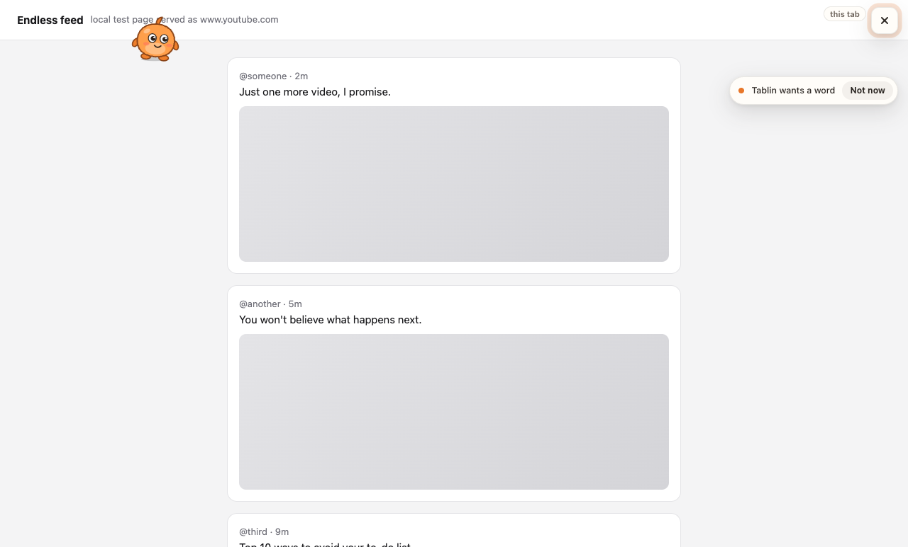
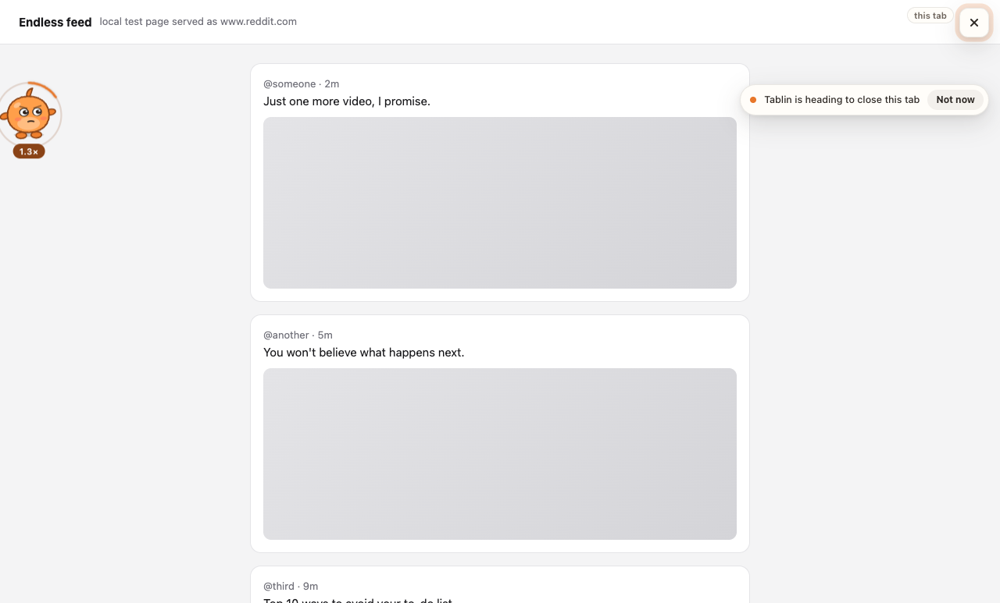
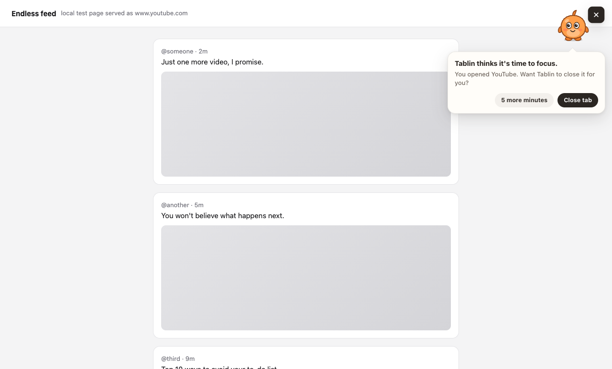
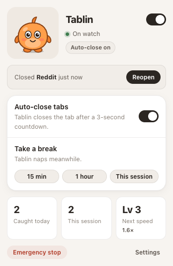

# Tablin

**A tiny companion that walks over and closes your distracting tabs.**

Open Instagram, TikTok, YouTube, Facebook, Reddit or X, and after a few seconds a small round
creature pops in at the top of the page. It notices you, turns, and heads for a close button in
the top-right corner. Grab it and pull it back to build tension, and it slingshots forward when you
let go. Keep coming back and it gets faster, up to a fair cap.

Tablin is a Chrome extension (Manifest V3). It's local-only: no accounts, no analytics, and no
network requests.

| Walking over                                                            | Slingshot                                                             | Nudge                                                               | Popup                                           |
| ----------------------------------------------------------------------- | --------------------------------------------------------------------- | ------------------------------------------------------------------- | ----------------------------------------------- |
|  |  |  |  |

> Screenshots are generated by the end-to-end test (`npm run test:e2e`) against a local test page,
> so they always reflect the current build.

---

## Contents

- [Features](#features)
- [Install (no coding needed)](#install-no-coding-needed)
- [How it works](#how-it-works)
- [Permissions](#permissions)
- [Privacy policy](#privacy-policy)
- [Development](#development)
- [Architecture](#architecture)
- [Known limitations](#known-limitations)
- [Troubleshooting](#troubleshooting)
- [Roadmap](#roadmap)
- [Contributing](#contributing)

## Features

**The character**

- An original SVG mascot with procedural animation: idle breathing, blinking, looking around
  (and at your cursor), walking, running, a startled "notice" hop, reaching for the close button,
  celebrating, sleeping, getting tired, and a determined "frustrated" mode.
- Squash and stretch, springs and pose blending, so state changes don't snap.
- Seven colors (Tangerine, Bubblegum, Lavender, Sky, Mint, Sunny, Cherry), three sizes, three
  animation intensities, and a custom name.
- Respects `prefers-reduced-motion`, with an override in settings.
- Optional sound effects, synthesized with WebAudio. They're off by default and use no audio files.

**Drag and slingshot**

- Grab the character at any time with Pointer Events and pointer capture. Only the character
  captures the pointer, and page scrolling is unaffected.
- Pulling it away from its destination stretches it like elastic and shows a tension ring with a
  live multiplier (up to 3×).
- Pulling farther and holding longer both build momentum. The drag distance is capped.
- On release it launches toward the exit on an underdamped spring. Speed is bounded.
- Press <kbd>Esc</kbd> while dragging to cancel the drag. A small pull just drops it back.
- Releasing never closes the tab. A visible 3-second cancel window always comes first.

**Escalation**

- Each interception in a period raises the level for the next one: the character notices you
  sooner and moves faster. Level 3 runs, level 4 speaks up, and level 5 and beyond is max speed.
- The speed cap (1–3×), curve (gentle, steady or steep) and reset period (daily or per browser
  session) are configurable, and you can turn escalation off.

**Safety and control**

- New installs start in **nudge mode**: the character asks and nothing closes on its own.
- Auto-close is opt-in. Before calling `chrome.tabs.remove`, the background worker re-checks that:
  the companion is enabled and not paused, auto-close is on, the tab is still the active tab, its
  URL still matches an enabled site, the tab isn't pinned or playing audio (configurable), the user
  hasn't snoozed, the page has no unsaved typed text, and the character appeared at least 2.5 s ago.
- Pause for 15 minutes, 1 hour, or the current browser session, plus an **Emergency stop**
  (<kbd>Alt</kbd>+<kbd>Shift</kbd>+<kbd>S</kbd>).
- "Not now" or <kbd>Esc</kbd> snoozes the current tab for 5 minutes. You can also cancel from the popup.
- Undo: reopen the last closed tab from the popup or with <kbd>Alt</kbd>+<kbd>Shift</kbd>+<kbd>Z</kbd>,
  for up to 10 minutes. The reopened tab gets a grace period.
- Per-site toggles and per-site countdowns (5–60 s, default 12 s), and you can add your own sites.

**Popup and settings**

- The popup shows a live character preview, status and countdown, an on/off switch, the auto-close
  toggle, pause buttons, today's and this session's counts, the next escalation level, undo, and
  emergency stop.
- The settings page has sections for General, Websites, Character, Behavior, Statistics (with a
  14-day activity chart and streaks) and About. It also contains the onboarding flow, which explains
  each permission.
- Works in light and dark themes.

## Install (no coding needed)

1. **Get the code.** Click **Code → Download ZIP** on GitHub and unzip it, or clone it:
   `git clone https://github.com/Krishiv-Vaid/tablin.git`
2. **Install dependencies.** Install [Node.js](https://nodejs.org) 20 or newer, then in the
   project folder run `npm install`.
3. **Build the extension.** Run `npm run build`. This creates a `dist/` folder.
4. Open **`chrome://extensions`** in Chrome.
5. Turn on **Developer mode** (top-right switch).
6. Click **Load unpacked**.
7. Select the **`dist`** folder inside the project.
8. **Pin Tablin.** Click the puzzle-piece icon in the toolbar, then the pin next to Tablin.
9. **Complete onboarding.** A welcome page opens automatically. Name your companion, pick a color,
   and read what each permission is for.
10. **Enable automatic closing if you want it.** Choose _Auto-close_ at the end of onboarding, or
    later in the popup or under Settings → General. Otherwise Tablin stays in nudge mode.

A ready-to-share ZIP is produced by `npm run package` at `release/tablin-<version>.zip`. It
contains the built extension (the same files as `dist/`) and is suitable for Chrome Web Store upload.
To load it unpacked, unzip it first and select the unzipped folder.

## How it works

1. You open a supported site. The countdown runs only while that tab is the active tab and visible.
2. If you switch away, the countdown pauses (or restarts; your choice). Background tabs are
   never touched.
3. When the countdown ends, the character enters at the top-left of the page, notices you, and
   walks (or runs) along the top edge toward the close button in the top-right corner.
4. When it arrives it reaches up and presses the button:
   - **Nudge mode:** it asks whether to close the tab, offering **Close tab** or **5 more minutes**.
     If you ignore it, it dozes off in the corner.
   - **Auto-close:** a 3-second countdown with **Keep this tab** (or <kbd>Esc</kbd>), then the
     worker verifies everything and closes that exact tab.

The content script never closes anything itself. It only reports page events and asks. All
decisions and the actual `chrome.tabs.remove` call happen in the background worker.

## Permissions

| Permission                                                                                                                | Why                                                                                                                                                |
| ------------------------------------------------------------------------------------------------------------------------- | -------------------------------------------------------------------------------------------------------------------------------------------------- |
| Host access to `instagram.com`, `tiktok.com`, `youtube.com`, `facebook.com`, `reddit.com`, `x.com` (and their subdomains) | To show the character on those sites, and to read those tabs' URLs to verify a tab before closing it. Tablin doesn't read or collect page content. |
| `storage`                                                                                                                 | Saves your settings, counters and the last closed tab's address on this device.                                                                    |
| `alarms`                                                                                                                  | Ends timed pauses on schedule even if the background worker was asleep.                                                                            |
| `scripting`                                                                                                               | Runs Tablin on sites _you add_ (after Chrome asks you for that one site), and on supported tabs that were already open when Tablin was installed.  |
| Optional host access (`*://*/*`)                                                                                          | Never granted up front. When you add a custom site, Chrome asks for permission for **that domain only**. Removing the site removes the permission. |

Tablin doesn't request the `tabs`, `history`, `webRequest` or `<all_urls>` permissions. It uses
`chrome.tabs` only for the tabs it already has host access to.

## Privacy policy

- No tracking, analytics, advertising or accounts.
- No network requests of any kind. Everything ships inside the extension, including fonts, art
  and sounds.
- Your browsing is never sent anywhere. Site detection runs locally against your site list.
- Stored locally in `chrome.storage`: your settings; daily counters (caught, closed, snoozed,
  reminders) kept for 120 days; the escalation count; the URL, title and tab position of the last
  tab Tablin closed (kept so you can reopen it, and offered for 10 minutes); and per-tab countdown
  state in session storage, which Chrome clears when the browser quits.
- Uninstalling the extension deletes all of it. **Settings → Statistics → Reset** clears the counters.

## Development

```bash
npm install        # dependencies
npm run dev        # rebuild dist/ on every change (then click ↻ on chrome://extensions)
npm run build      # typecheck + production build into dist/ + manifest/file verification
npm test           # unit tests (Vitest)
npm run lint       # ESLint + Prettier check
npm run package    # build + release/tablin-<version>.zip
npm run test:e2e   # end-to-end in real Chrome for Testing (downloads it once into .cache/)
npm run icons      # regenerate toolbar icons (procedural, no image tools needed)
```

### Testing

- **Unit tests** (about 150 tests) cover domain and subdomain matching, lookalike domains, the
  countdown, cancellation, active-tab verification, pinned and audible protection, unsaved-input
  protection, escalation curves and caps, drag clamping, tension and charge, launch velocity, spring
  behavior, the character state machine and controller (walk, run, drag, slingshot, arrival),
  settings validation, storage persistence, message routing and sender checks, rapid tab switching,
  reloads, duplicate events, disabled sites, pauses, emergency stop, undo, and service worker
  suspension (a fresh manager over the same storage).
- **End-to-end** (`tests/e2e/run-e2e.mjs`) loads `dist/` into Chrome for Testing. Every request is
  intercepted: supported-site URLs are answered with a local fixture page and everything else is
  blocked. It then checks that the character appears after the countdown and walks, that nudge mode
  doesn't close the tab, that "5 more minutes" works, that a real mouse drag charges the slingshot
  and the release launches it, that the cancel window appears and the correct tab closes, that undo
  reopens it, that "Keep this tab" keeps it, that switching tabs prevents background closure, that
  pinned tabs are protected, that escalation increases, that emergency stop works, that color
  changes persist, and that settings survive a Chrome restart.
- CI (GitHub Actions) runs typecheck, lint, unit tests, build and package, and uploads the ZIP as
  an artifact.

## Architecture

```
src/
  background/            Manifest V3 service worker (no persistent state in memory)
    service-worker.ts      Chrome event wiring, badge, alarms, custom-site scripts
    distraction-manager.ts Per-tab lifecycle: waiting → counting → appeared; pause/snooze/undo
    escalation-manager.ts  Levels, speed curve, delay shortening, approach plans (pure)
    tab-manager.ts         verifyClosable() safety gate + chrome.tabs adapter
  content/               Content script: page ↔ worker bridge
    content-script.ts      Reports page lifecycle, runs the local timer, shows the overlay
    overlay/               Closed-shadow-root UI: exit button, status chip, speech bubble
    unsaved-input.ts       "Don't close while you're typing" heuristic
  character/             Browser-agnostic character engine (no chrome.* APIs)
    Character.ts           Facade: DOM element, animation loop, drag, sound
    CharacterController.ts Movement modes, physics integration, slingshot (headless, testable)
    CharacterPhysics.ts    Springs, drag limits, tension/charge, launch velocity (pure)
    CharacterStateMachine.ts  States and allowed transitions
    CharacterAnimations.ts Procedural poses, blending, blink and look-around schedulers
    CharacterRenderer.ts   Applies poses to the SVG rig
    DragController.ts      Pointer Events + capture, Escape and pointercancel handling
    CharacterSound.ts      WebAudio-synthesized effects
    characters/            Character designs (SVG rig builders) and color palettes
  detection/             Site registry and URL matching
  shared/                Types, constants, settings validation, storage, stats, messages
  popup/  options/  ui/  React UI and a small shared design system
public/manifest.json     Extension manifest (built into dist/)
tests/unit  tests/e2e    Vitest unit tests; real-Chrome end-to-end runner
scripts/                 Icon generator, build verifier, ZIP packager, dev watcher
```

Key decisions:

- **The worker is authoritative and stateless in memory.** Every event loads state from
  `chrome.storage`, mutates it, persists it, and only then notifies tabs. Events are serialized, so
  rapid tab switching can't interleave updates. Countdown deadlines are stored as timestamps. The
  content script's timer, plus an in-memory backup timer, merely _trigger_ re-verification, so the
  worker can be suspended at any point.
- **The character engine knows nothing about Chrome.** `CharacterController` is driven by
  `update(dt)` and tested headlessly. The same engine renders the popup preview, and it could run
  in a future native companion's web view.
- **The page overlay lives in a closed shadow root.** It builds its DOM with `createElement`
  (no `innerHTML`, which keeps it safe on Trusted Types pages) and uses constructable stylesheets
  (which page CSP doesn't block). Only the character and buttons accept pointer events.
- **Messages are validated and sender-checked.** Content-script messages must come from a tab.
  Popup-only commands (pause, reset and so on) must come from Tablin's own pages, so a web page
  can't drive them.

See [docs/ARCHITECTURE.md](docs/ARCHITECTURE.md) for the state diagrams.

## Known limitations

- **Tablin can't draw on Chrome's tab strip.** Extensions can't render over the browser's own UI.
  The character walks along the top edge of the _web page_ to a stand-in close button, and the tab
  is closed through `chrome.tabs.remove`. A future desktop companion could go further (see the roadmap).
- It doesn't run on pages Chrome reserves (`chrome://`, the Web Store, PDFs in the built-in viewer)
  or in iframes.
- Unsaved-input detection is a heuristic: typed text in inputs, textareas and contenteditable
  editors that wasn't submitted. Sites with unusual editors may not be detected.
- A countdown counts while the tab is active and visible in its window, even if Chrome itself
  isn't focused.
- Tabs that were already open on a site you just _added_ need a reload before Tablin runs there.
- On sub-sites such as YouTube Studio, the whole domain counts. There's no per-path rule yet.

## Troubleshooting

| Problem                                  | Fix                                                                                                                                                                                            |
| ---------------------------------------- | ---------------------------------------------------------------------------------------------------------------------------------------------------------------------------------------------- |
| Nothing happens on YouTube etc.          | Check the popup: the companion must be on and not paused, and the site enabled under Settings → Websites. Wait the full countdown with the tab in front. Reload tabs opened before installing. |
| "Load unpacked" fails                    | Select the `dist` folder (not the project root), and run `npm run build` first.                                                                                                                |
| Changes don't show up during development | Run `npm run dev`, then click ↻ for Tablin on `chrome://extensions` and reload the page.                                                                                                       |
| The tab didn't close                     | Auto-close is off by default. Pinned tabs, tabs playing audio, and pages where you've typed something are protected on purpose.                                                                |
| I want it gone right now                 | Press <kbd>Esc</kbd>, click **Not now**, use **Emergency stop** in the popup (<kbd>Alt</kbd>+<kbd>Shift</kbd>+<kbd>S</kbd>), or turn the switch off.                                           |
| Shortcuts don't work                     | Another extension may own them. Set your own at `chrome://extensions/shortcuts`.                                                                                                               |
| `npm run test:e2e` can't find Chrome     | It downloads Chrome for Testing into `.cache/`. Set `CHROME_PATH` to use an existing Chrome for Testing binary (branded Chrome no longer supports `--load-extension`).                         |

## Roadmap

- **macOS desktop companion (SwiftUI + AppKit).** A transparent, click-through `NSPanel` that
  draws the character _above_ browser windows, so it can walk to the real tab strip.
  Chrome ↔ macOS communication would use native messaging (`chrome.runtime.connectNative`), with
  the extension still the source of truth for tab state. The character engine is browser-agnostic
  so it can be reused in a `WKWebView` or ported.
- Safari Web Extension build (shared engine and worker logic).
- More characters (the `characters/` design registry is ready), accessories, unlockable animations,
  and custom character imports.
- Richer focus sessions: schedules, focus timers, allow-lists, and per-path rules.
- Chrome Web Store release.

## Contributing

Issues and pull requests are welcome.

1. Fork and create a branch.
2. `npm install`, then make your change with tests.
3. `npm run check` (typecheck, lint, unit tests, build) must pass. Run `npm run test:e2e` for anything
   touching the worker, content script or character.
4. Keep the privacy promise: no network requests, analytics or new permissions without
   discussion.

## License

[MIT](LICENSE)
